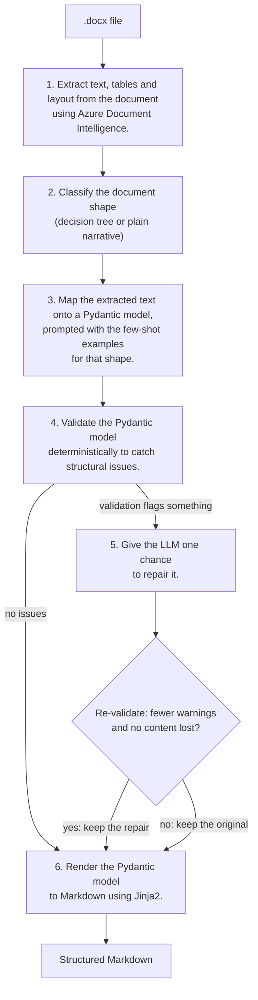

How many times have you received a document that's messy, unstructured, or just plain hard to work with? Now imagine you need a whole stack of them as source material for an AI app. That was my task: Word documents, some laid out as decision trees, some as plain narratives. Structure tells a model what matters and how the pieces connect, so the goal was to turn those documents into a clean, structured Markdown format. To get there, I built a pipeline where [Azure Document Intelligence](https://learn.microsoft.com/en-us/azure/ai-services/document-intelligence/?view=doc-intel-4.0.0) extracts the content, [Pydantic](https://pydantic.dev/docs/validation/latest/get-started/) enforces the structure, and [Jinja2](https://jinja.palletsprojects.com/en/stable/) renders the Markdown. I also used [Claude from Anthropic](https://www.anthropic.com/) for every step that needed an LLM, but you can swap in any LLM you prefer.

### The pipeline


The pipeline runs in six stages. The Azure Document Intelligence prebuilt-layout model extracts text, tables, and layout from the source document. A classifier then determines whether the document is a decision tree or a plain narrative, and injects the appropriate few-shot examples into the LLM prompt. The LLM maps the extracted text onto a Pydantic model, which is then validated deterministically to catch structural issues. If it flags a problem, the LLM gets one chance to repair it and the repaired version goes back through validation. Finally, the Pydantic model is rendered to Markdown using Jinja2.

> **The idea behind the design is that no stage trusts the one before it.** Mapping rebuilds the structure instead of assuming extraction kept it, validation checks the mapping without asking an LLM, and a repair is only kept if it passes the same checks again.


For this pipeline, a document can be one of two shapes:
- a **decision tree** or
- a **plain narrative**

A decision tree is a branching structure, where each step leads to one or more outcomes, and the flow is determined by the answers to questions.

> *"who is calling? → is the identity confirmed? → go to step 4"*

A plain narrative is linear text, read top to bottom, with no branching.

> *"This document has information for..."*

The goal is simple: **turn either shape into a structured Markdown file that can be easily read and processed.**


### Before we start: the sample documents for the demo

The pipeline needs documents to run on, so the first thing to build was a small set of samples. They are written as generic "customer support call scripts", but the domain is arbitrary. The same pattern applies just as well to onboarding SOPs, IT runbooks, compliance procedures — anywhere structured and unstructured documentation coexist.

For this demo, I created 3 synthetic tree documents and 3 synthetic narrative documents, designed to represent the two document shapes the pipeline is built to handle: 
- tree documents follow a decision-tree structure
- narrative documents are plain, linear text, read top to bottom.

Those six are then split two ways, and the split matters. Four of them stay in `synthetic_docs` and become the few-shot examples the model is shown at mapping time. They don't go to the model as Word files: the script `src/create_few_shot_examples/create_raw_examples.py` runs each one through the same Azure extraction the pipeline uses and saves the result to the `few_shot_examples` folder, where I paired it with the gold standard for each document. The remaining two, one of each shape, are held out in `sample_inputs` as the documents the demo actually processes. Nothing the pipeline runs on has ever been shown to the model as an answer.

> Feel free to swap in your own documents immediately — this step is just there so you can run the demo out of the box, without needing to supply anything yourself.


### Step 1: Extracting data with Azure Document Intelligence
[Azure Document Intelligence](https://learn.microsoft.com/en-us/azure/ai-services/document-intelligence/?view=doc-intel-4.0.0) reads a document and returns its text along with the layout it detects: headings, paragraphs, tables, and the boxes of a drawing. To run the demo, you'll need an Azure Document Intelligence resource, plus its endpoint and key.

> The code snippets in this article are trimmed to the essentials: imports, docstrings and logging are left out. The full, runnable code is in the [repo](https://github.com/agileactors/agile-actors-azure-doc-to-md).

```python
endpoint = os.environ["AZURE_DOCUMENT_INTELLIGENCE_ENDPOINT"]
key = os.environ["AZURE_DOCUMENT_INTELLIGENCE_KEY"]
```

> I built this whole demo on the free tier (F0), which gives you 500 pages a month at no cost. The F0 only reads the first two pages of each document, so if your file is longer, the rest is simply dropped, and you don't get any error or warning about it. The sample documents are short, so it did not matter here, but longer files would require a paid tier. For details, see the [Azure Document Intelligence pricing page](https://azure.microsoft.com/en-us/pricing/details/document-intelligence/).

In this demo, I am going to use two documents, one in a **decision tree shape** and one in a **plain narrative shape**. You can find these documents in the `sample_inputs` folder.

In order to extract the text from these documents, I will use the `prebuilt-layout` model of Azure Document Intelligence. It handles a wide range of layouts, and it can return its output as Markdown. That matters, because the layout it detects is encoded right in the text: section titles come back as `#` or `##` headings instead of plain lines, and tables come back as pipe tables instead of a loose run of cell values. The next steps can then work with that structure instead of rebuilding it from scratch. If you want to go deeper on what the model can do, the [Azure Document Intelligence documentation](https://learn.microsoft.com/en-us/azure/ai-services/document-intelligence/?view=doc-intel-4.0.0) is a good next stop.


```python
def extract_text(source_path: str | Path) -> str:
    """
    Call Azure AI Document Intelligence (prebuilt-layout) on a real file.
    """

    client = DocumentIntelligenceClient(
        endpoint=endpoint, credential=AzureKeyCredential(key)
    )

    with open(source_path, "rb") as source_file:
        poller = client.begin_analyze_document(
            "prebuilt-layout",
            body=source_file,
            # output the extracted text in Markdown format
            output_content_format=DocumentContentFormat.MARKDOWN,
        )
    result = poller.result()
    return result.content
```

### Step 2: Classifying the document shape

The next step is the classification of the extracted text: is the document a decision tree or a plain narrative? The label determines which set of few-shot examples gets loaded into the LLM's prompt for the mapping step, and showing the model examples of the right shape is what helps it understand the document's structure and content. I used *Claude* for the classification step, but you can use any LLM you prefer.

> Note: A Vision Language Model (VLM) could do this classification instead, since it sees what text extraction loses, like arrow direction and spatial layout. But a VLM costs more and needs an extra step to render the document as an image, so this demo classifies from the extracted text alone. If you'd rather use a VLM, feel free to swap in your own classifier here. 


```python
def classify(raw_text: str) -> str:
    """
    Classify a document as "tree" or "narrative".
    """
    client = get_client()  # Anthropic client
    response = client.messages.create(
        model=MODEL_NAME,
        max_tokens=16,  # Keep it short, we only need a label.
        thinking={"type": "disabled"},
        system=CLASSIFY_PROMPT,  # Tells the model how to classify.
        messages=[{"role": "user", "content": raw_text}],
    )

    # _first_text returns the first text block of the response.
    label = _first_text(response).strip().lower()
    print(f"Label is {label!r}")
    return "tree" if "tree" in label else "narrative"
```


Few-shot examples live in the `few_shot_examples` folder, organized one subfolder per category. Within each category, examples are paired by filename:
- a `<name>_raw.txt` file holding the example document,
- matched with a `<name>_expected.json` file holding what that document should map to.

Drop a new `<name>_raw.txt` / `<name>_expected.json` pair into a category folder, and the pipeline picks it up automatically. Just make sure every raw file has its matching expected file.

> You might be wondering whether classifying first is really necessary, rather than just showing the model every few-shot example regardless of shape. Honestly, with only one or two examples per category, it isn't, because cost and latency won't be an issue either way. It's really up to you and what your project needs. That said, I'd still lean toward including it, since it means you won't have to rewrite the pipeline later if things scale up.


### Step 3: Mapping onto a Pydantic model

#### Defining the data model

[Pydantic](https://pydantic.dev/docs/validation/latest/get-started/) is a data validation library for Python: you define your data as typed models, and it makes sure whatever comes in actually matches that shape. That's exactly what we need here, a way to catch inconsistencies or errors in the LLM's output early, before they ripple further down the pipeline.

Rather than having two separate schemas, one for trees, one for narratives, I used a single `CallScript` model that holds the fields common to both shapes, plus the fields specific to each case. A single validator then enforces the one rule that ties it all together: a document must be a tree *or* a narrative, never both, and never neither.

> Why use Pydantic at all, when the LLM only needs a JSON `input_schema`. Function calling features in most LLMs already let you define a schema and get structured output, so why not just write that schema by hand? Because here the schema *comes from* Pydantic: the `input_schema` handed to the LLM is generated with `CallScript.model_json_schema()`. **One class is both the schema the LLM sees and the validator that checks its answer**, so the two can never drift apart. On top of that, Pydantic can enforce rules a JSON schema can't express, like the tree-or-narrative rule, which runs as a Python validator once the response arrives.


Every script has a few shared fields, plus a few that depend on its shape:

| Field | Decision tree | Narrative | What it holds |
|---|:---:|:---:|---|
| **Title** (`title`) | ✅ | ✅ | The name of the procedure |
| **Category** (`category`) | ✅ | ✅ | The high-level grouping, e.g. "Billing" or "Technical Support" |
| **Attention Points** (`attention_points`) | ✅ | ✅ | Significant information the agent must not miss |
| **Steps** (`steps`) | ✅ | | The questions the agent works through, each with its branches |
| **Outcomes** (`outcomes`) | ✅ | | Where those branches end up |
| **Main Text** (`main_text`) | | ✅ | The body of a narrative document, restated word for word as free-form prose |


```python
class CallScript(BaseModel):
    """
    A CallScript describes either a decision-tree call flow or a
    plain-narrative procedure, never both.
    """

    # common fields
    title: str = Field(..., description="The name of the procedure.")
    category: str | None = Field(
        default=None,
        description="High-level grouping, e.g. 'Billing', 'Technical Support'.",
    )
    attention_points: list[AttentionPoint] = Field(
        default_factory=list,
        description=(
            "Warnings or caveats the agent must not miss, preserved in the "
            "order and nesting they appeared in the source document."
        ),
    )

    # Decision-tree shape
    steps: list[DecisionStep] = Field(default_factory=list)
    outcomes: list[Outcome] = Field(default_factory=list)

    # Plain-narrative shape
    main_text: str | None = Field(
        default=None,
        description="Free-form procedure text, used for non-tree documents.",
    )

    @model_validator(mode="after")
    def check_single_shape(self) -> "CallScript":
        """Enforce that a document is a tree OR a narrative, never both."""
        is_tree = bool(self.steps)
        is_narrative = bool(self.main_text)

        if is_tree and is_narrative:
            raise ValueError(
                "A CallScript cannot have both `steps` and `main_text` set — "
                "pick one shape."
            )
        if not is_tree and not is_narrative:
            raise ValueError(
                "A CallScript must have either `steps` or `main_text` set."
            )
        return self
```

#### Mapping the extracted text onto the model

With the text extracted and the shape classified, the next step is mapping that text onto the `CallScript` model. The LLM has no built-in knowledge of the model or its fields, so the request has to spell everything out. It includes:

- **Instructions** (the system prompt) describing the model's structure and how to map the text onto it
- **Few-shot examples** for the classified shape, passed as earlier conversation turns, so the model can see how similar documents were mapped before
- **The extracted text** of the document itself

The demo uses *Claude*, but any LLM that supports structured output will work. The output is then parsed into a `CallScript` object.

> Note: All the prompts used in the pipeline live in the `src/prompts/` folder. Keep in mind that they're built for this demo, **not as a general-purpose template**. The mapping prompt starts with the basics: never invent information and never drop it. Then it covers the trickier edge cases:
>
> - Pick exactly one shape, tree or narrative. Never both, never neither.
> - Make every branch point to a step or outcome that actually exists.
> - Treat outcomes as endpoints. They never route anywhere else.
> - Keep every sentence of narrative content, without summarizing.

```python
def map_to_schema(raw_text: str, category: str) -> CallScript:
    """
    Map raw text into a validated CallScript.
    """
    client = get_client()  # Anthropic client
    few_shot = load_few_shot_examples(category)

    messages = []
    for example_raw, example_expected in few_shot:
        messages.append({"role": "user", "content": example_raw})
        messages.append({"role": "assistant", "content": example_expected})
    messages.append({"role": "user", "content": raw_text})

    tool = {
        "name": "record_call_script",
        "description": (
            "Record the CallScript structure extracted from the source text."
        ),
        "input_schema": CallScript.model_json_schema(),
    }

    response = client.messages.create(
        model=MODEL_NAME,
        max_tokens=16000,
        system=AGENT_PROMPT,
        messages=messages,
        tools=[tool],
        tool_choice={"type": "tool", "name": "record_call_script"},
    )

    tool_call = next((b for b in response.content if b.type == "tool_use"), None)
    return CallScript.model_validate(tool_call.input)
```

> **Note:** The demo uses Claude's **tool use** to get structured output. You define a tool whose `input_schema` is the JSON schema of your Pydantic model, then force the model to call that tool. Claude also offers native structured outputs, which guarantee the response matches your schema. Most other LLMs support the same idea through their own schema or function-calling features.

### Step 4: Validating the Pydantic model

LLMs can hallucinate or misread the source text, so trusting the mapping step's output blindly is risky. Instead, I added a *deterministic* validation step that checks the `CallScript` object's structure for common issues. It catches the most common errors early, before they reach the rendered Markdown.


The validation step checks for several common issues, each caught by its own function. Which checks apply depends on the document's shape:

| Check | Applies to | What it catches |
|---|---|---|
| **Dangling references** | Decision trees | A step that points to an outcome or step that doesn't exist, leaving the agent at a dead end mid-call |
| **Unreachable steps and outcomes** | Decision trees | A step or outcome that nothing points to, usually a dropped or misplaced branch (the first step is exempt, since it's the entry point) |
| **Ungrounded nodes** | Decision trees | A step or outcome whose wording matches no line in the source (below 80% word overlap), usually an invented node |
| **Narrative coverage** | Narratives | A source sentence with less than 80% of its words in `main_text`, often from the model quietly summarizing or skipping sentences |
| **Narrative size** | Narratives | A `main_text` with more words than the source body, usually a sign the model added something |
| **Attention-point coverage** | Every script | A caveat under the source's "Attention points" heading that matches no single attention point at 80% word overlap |
| **Shape conflicts** | Every script | Both `steps` and `main_text` filled in, or neither |

> **Note:** The three overlap checks share one threshold: 80% of a source line's distinct words must appear in the output. It's loose enough to let the model reflow a paragraph or fix a typo, and strict enough to catch a summarized or dropped sentence. The last check, shape conflicts, is a safety net: the Pydantic model already rules them out, but a `CallScript` built with `model_construct()` skips validation.

None of these checks stop the pipeline. Each one returns a warning instead of raising an error, and those warnings decide what happens next: if the list is empty, the script goes straight to rendering. If not, the warnings are handed to the repair step, so the model knows exactly what to fix.


```python
def sanity_check(script: CallScript, raw_text: str) -> list[str]:
    """
    Run all structural checks and return a list of warning strings.
    """
    warnings: list[str] = []

    # Narrative-only checks
    if script.main_text:
        warnings.extend(_check_narrative_coverage(script, raw_text))
        warnings.extend(_check_narrative_size(script, raw_text))

    # Tree checks (no-ops on narratives, which have no steps or outcomes)
    warnings.extend(_check_dangling_references(script))
    warnings.extend(_check_unreachable_nodes_and_outcomes(script))
    warnings.extend(_check_grounding(script, raw_text))

    # Shape-agnostic checks
    warnings.extend(_check_attention_coverage(script, raw_text))

    # a safety net
    warnings.extend(_check_shape_conflict(script))

    return warnings
```

The first two tree checks only look at the graph, so they can't tell a real box from one the model made up. If a branch points at an invented outcome, the reference resolves and the outcome is reachable, so the graph looks perfect. The `_check_grounding` goes back to the source: it compares the wording of every step and outcome against the extracted text, line by line. An invented box won't match any line, so it gets flagged.

Narratives have the same blind spot. `_check_narrative_coverage` walks the source and asks whether each sentence made it into `main_text`, so a sentence that exists only in the output is never examined, and its extra words can even help other sentences reach the threshold. The `_check_narrative_size` closes that gap with a simple count: `main_text` restates the source body word for word, so its size should never be larger than the body's.

Attention points had a blind spot of their own. Narrative coverage stops at the "Attention points" heading, and grounding only looks at steps and outcomes, so a dropped caveat passed every check, even though caveats are exactly what the agent must not miss. The attention-point coverage check applies the same 80% threshold to every line under that heading, matching each one against a single attention point, nested ones included.

> **Note:** A script can pass every check and still be wrong. The validation step is not a guarantee of correctness, only a way to catch common structural issues that are easy to check for deterministically. It is still possible for the model to misinterpret the source text or make other mistakes that the checks don't catch. The goal is to catch the low-hanging fruit, so human review can focus on what the checks can't see.


### Step 5: Repairing the Pydantic model

If validation flags anything, the LLM gets exactly **one attempt** to repair it: it's shown the validation errors and asked to produce a corrected version of the object. I capped it at one try on purpose. Without a limit, the model could keep "fixing" the same problem in a loop, burning time and tokens without ever getting it right. I used *Claude* for the repair step, but as I mentioned before, you can use any LLM you prefer.

Here's the part worth calling out, because it's easy to get wrong: checking that the warning count went down isn't enough. Say the model gets a *"dangling reference" warning*. The easiest way to make it disappear is to simply *delete* the branch that causes it. The warning is gone, but the script has lost content, as we discussed in the previous step, so it's actually worse than before.

That's why a repair is only accepted if it passes two checks:

1. **It reduces the number of warnings.**
2. **It doesn't lose any content.** The `CallScript` model's `content_size` property counts every step, outcome, and branch in a tree, every word in a narrative, and every attention point in both, nested ones included. The pipeline compares it before and after the repair. If the number drops, something was deleted, and the repair is rejected.

``` python
@property
def content_size(self) -> int:
    """
    Rough size metric used to detect a repair that deletes content.
    """
    branch_count = sum(len(step.branches) for step in self.steps)
    narrative_words = len(self.main_text.split()) if self.main_text else 0
    attention_count = len(flatten_attention_points(self.attention_points))
    return (
        len(self.steps)
        + len(self.outcomes)
        + branch_count
        + narrative_words
        + attention_count
    )
```

If either check fails, the pipeline keeps the current script and its warnings for a human to review.

> **Note:** At the end of the repair step, the remaining warnings are stored in a `warnings.txt` file in the `outputs` folder alongside the final Markdown output. The file only covers what's *left* after repair: if a repair was accepted, the warnings it fixed aren't recorded anywhere. For a full history of what was flagged and fixed, you'd need to add your own logging around `attempt_repair`'s return values.

Putting it together, the repair step sends the mapped `CallScript`, its warnings and the original text back to the LLM. The response is parsed into a new `CallScript` object, which is then re-validated. If the repair passes both checks above, it replaces the original. Otherwise, the original is kept. Either way, the pipeline continues to rendering, and any warnings that remain are written to `warnings.txt` for human review.


```python
def attempt_repair(
    script: CallScript, warnings: list[str], raw_text: str
) -> tuple[CallScript, list[str], bool]:
    """
    Attempt exactly one repair call and apply the acceptance gate.
    """
    if not warnings:
        return script, warnings, False
    # Repair the script and re-validate it.
    candidate = llm_repair(script, warnings, raw_text)
    candidate_warnings = sanity_check(candidate, raw_text)
    # check that the repair reduced the number of warnings and didn't delete content
    warnings_improved = len(candidate_warnings) < len(warnings)
    size_preserved = candidate.content_size >= script.content_size

    if warnings_improved and size_preserved:
        return candidate, candidate_warnings, True

    return script, warnings, False
```

> Why does the repair step need the original text? Some warnings can be fixed from the object alone: if a branch points to a step or outcome that doesn't exist, the model can see that and repair it on the spot. But if the model dropped a paragraph of narrative text, nothing in the object shows what went missing. Only the source does, which is why the repair prompt includes it.


### Step 6: Rendering the Pydantic model to Markdown with Jinja2

The final step is where things come together: rendering the `CallScript` model to Markdown with [Jinja2](https://jinja.palletsprojects.com/en/stable/), a Python templating engine that lets you define exactly how each field of the model turns into Markdown — layout, formatting, structure, all of it. The same template handles both decision trees and plain narratives, so there's no need to maintain two versions. Rendered this way, the output ends up structured underneath and easy to read on top.


The template for this demo outputs the *title*, *category* and *attention points* unconditionally. Even when a section is empty, it still renders with a placeholder like "_None._" rather than being skipped. That's deliberate: an empty section is a recorded fact (*"this document has no attention points"*), while an omitted one would be indistinguishable from something the mapping step simply missed.

From there, the template branches into two independent, shape-specific cases:

- when `script.steps` is set, it outputs the call flow and outcomes (the tree shape);
- when `script.main_text` is set, it outputs the narrative text instead.

The template checks both conditions independently rather than treating them as an if/else. The schema already guarantees exactly one is set — this just means the template doesn't break if a `CallScript` ever reaches it another way.

You can find the template in `templates/template_script.md.j2`. 

```python
def render_markdown(script: CallScript) -> str:
    """Render a CallScript into final Markdown using the Jinja2 template."""
    jinja_env = Environment(
        loader=FileSystemLoader(TEMPLATES_DIR),
        trim_blocks=True,
        lstrip_blocks=True,
    )
    template = jinja_env.get_template("template_script.md.j2")
    rendered = template.render(script=script)
    rendered = re.sub(r"\n{3,}", "\n\n", rendered)
    return rendered.strip() + "\n"
```

### Outputs

In the `outputs` folder, each document gets its own subfolder named after the source file. Inside that subfolder, you'll find:

- `final.md` — the rendered Markdown output
- `raw.txt` — the raw text extracted from the source document using Azure Document Intelligence
- `warnings.txt` — the warnings that survived repair, or `No warnings - all checks passed`.

#### Narrative example

The narrative case is the simpler of the two, because the source is already linear text. The pipeline still extracts, maps, validates, and renders it, but the mapping stage doesn't have to reconstruct a graph from labels alone.

What it does instead is **decompose** the document. `sample_inputs/complaints_handling_overview.docx` arrives from the extractor as one undifferentiated block of text, and every line of it has to be routed to the field it belongs to:

```
Complaints Handling Overview                       →  title
Category: Complaints Process                       →  category  ("Complaints Process")

This document explains how customer complaints…    →  main_text
A complaint is any expression of dissatisfaction…      (the body, in full)
Every complaint is recorded on the day…
…

Attention points                                   →  attention_points
Log any expression of dissatisfaction…                 (as a nested list)
Record the following on the day…:
The customer's own wording, not a paraphrase.
…
```

Here's what the rendered Markdown looks like, from `outputs/complaints_handling_overview/final.md`:

```markdown
# Complaints Handling Overview

**Category:** Complaints Process

## Attention points

- Log any expression of dissatisfaction, whether or not the customer calls it a complaint.
…

## Main Text

This document explains how customer complaints are recorded, handled, and closed. It describes the principles consultants work to rather than a fixed sequence of steps.

…

```

**Every line of the source lands in exactly one place.**
Decomposing a document is exactly the operation where content goes quietly missing — a line that belongs to no field is a line that gets dropped — so this is the property worth checking, and it's checkable rather than a matter of impression:

- all 17 sentences of the body appear in `main_text` at 100% word overlap, so the text was carried across intact rather than paraphrased. The 80% threshold is there to let the model reflow a paragraph without that counting as data loss, but on this document it never had to.
- all 10 attention-point lines are carried through verbatim, wording untouched;
- the title and category are captured as their own fields, so they can be indexed and grouped without parsing prose.


#### Decision tree example

This is the case worth looking at closely, because the pipeline has to *recover* something that extraction destroyed.

The source is `sample_inputs/password_reset_procedure.docx`: a flowchart drawn in Word, with decision diamonds, terminal boxes, and labelled arrows connecting them. Here's exactly what Azure Document Intelligence returns for it, annotated with what the mapping stage turned each line into:

```
# Password Reset Procedure                                     → title
Category: Reset Process                                        → category: "Reset Process"
This document describes the decision process...                → (boilerplate, not stored)
Customer requests password reset                               → (the flowchart's start box, not stored)

## Identity verified via standard two-way authenticator?       → STEP_1 (question)
## No                                                          → STEP_1 branch "no"
## Yes                                                         → STEP_1 branch "yes"
## Reject the request                                          → OUTCOME_1
## Suspicious activity detected on the account?                → STEP_2 (question)
## No                                                          → STEP_2 branch "no"
## Yes                                                         → STEP_2 branch "yes"
## Inform the Security Team                                    → OUTCOME_2
## Password reset link sent                                    → OUTCOME_3
```

> **Note:** Two lines are intentionally left out of the output. The first is the intro sentence: every sample tree opens with a similar high-level summary of the procedure, and since it gives the agent nothing it needs to follow the flow, I don't store it. The second is the flowchart's entry point, *Customer requests password reset*. It isn't a question, so it isn't `STEP_1`. It's the trigger that tells the agent when to use the flow, and a tree `CallScript` has no field for it. If you'd rather keep either one, add a field to the `CallScript` model and update the mapping prompt to fill it.

Every label survived extraction. **The arrows did not.**
All nine `##` lines are flat — same heading level, reading order only, no indication of which `Yes`/`No` belongs to which question, or where either one leads. The topology, which is the entire content of a decision tree, is gone.

**Rebuilding it is the actual job handed to the mapping stage**: match each `Yes`/`No` back to its question, and each terminal line to the branch that leads to it, using the few-shot examples and the wording as the only signals.

Here's what the rendered Markdown looks like, from `outputs/password_reset_procedure/final.md`:

```markdown
# Password Reset Procedure

**Category:** Reset Process

## Attention points

- Never process a reset without completing identity verification first.
- Temporary passwords must only be sent through a verified channel, such as the registered email address or phone number.
- If suspicious activity is detected, place a security hold and refer to fraud prevention before resetting.

## Call flow

**STEP_1.** Identity verified via standard two-way authenticator?
- If **no** → `OUTCOME_1`
- If **yes** → `STEP_2`

**STEP_2.** Suspicious activity detected on the account?
- If **yes** → `OUTCOME_2`
- If **no** → `OUTCOME_3`

## Outcomes

- **OUTCOME_1** (Reject the request): Reject the request
- **OUTCOME_2** (Inform the Security Team): Inform the Security Team
- **OUTCOME_3** (Password reset link sent): Password reset link sent
```

Every branch lands on the outcome it should: an unverified identity is rejected, a verified one moves to the suspicious-activity check, which routes to either the Security Team or the reset link — exactly the arrows drawn in the original flowchart, reconstructed from labels alone. Validation passed every check: no dangling references, no unreachable steps or outcomes, no ungrounded nodes, and no missing attention points.

This is also where the deterministic checks earn their place: a model reassembling a graph from semantics alone *can* point a branch at a step that was never defined — invisible in prose, trivial to catch in a structure.


### What if the source document is wrong?

The pipeline can only be as reliable as the documents it reads. The sample documents for this demo are clean and correct: for example, in `sample_inputs/password_reset_procedure.docx`, every question is the right one to ask and every branch ends where it should. Unfortunately, real documents aren't always that reliable. If a source tree has a box that no arrow reaches, or a question with only one branch, that's a mistake in the source, and the pipeline won't fix it. It shouldn't: fixing it would mean guessing what the author meant, which is exactly the invention every stage is built to prevent. Every stage carries the source across faithfully, *never invent, never drop*, so a broken source produces a broken output. The checks compare the output against the source, not the source against reality.


> **Note:** Sometimes a warning points at the source rather than the mapping. A box in a decision tree that nothing leads to, for example, can come through as an unreachable outcome. When that happens, the fix belongs in the original document, not in the pipeline.


### Wrapping up

So, back to the question I opened with: what do you do with a document that's messy, unstructured, or just plain hard to work with? This pipeline is an answer, not the only one, but it works well enough to be worth sharing. 

*A messy Word document goes in. Azure Document Intelligence extracts the text and layout, a classifier decides whether it's a decision tree or a narrative, an LLM maps it onto a Pydantic model, deterministic checks flag what came out wrong, one gated repair attempt fixes what it can, and Jinja2 renders the result as a structured Markdown.*

**The part that matters is that no stage trusts the one before it.**

> The goal was never a pipeline that never gets it wrong — it's one that tells you when it might have, and is honest about the few cases where it can't.

Worth being upfront about the rough edges too: **this only works as well as extraction does**, and extraction has real limits. Nothing downstream can recover what never comes back from it.

- **Some shapes come back empty.** Word can store a shape's text in more than one internal format, and if the label isn't in the one extraction reads, the box arrives with no text at all. The step or outcome it held is simply missing, and the mapping stage has no way of knowing it was ever there.
- **Connector arrows never survive.** Arrows are lines without text, so extraction drops them and returns only the labels, in reading order. That's the whole reason the mapping stage has to rebuild the routing, and why a confusing layout can lead to a wrong route that every check accepts.
- **ASCII flowcharts are a risk.** A flowchart typed with characters like `+---+`, `|` and `-->` instead of drawn with shapes comes back as plain lines of text, with runs of spaces collapsed. Those spaces were what kept side-by-side boxes in separate columns and lined each connector up under its box. Without them, two labels on the same line read as one, and the connectors no longer point at anything. The validator won't catch a wrong split: grounding checks that a label's words appear in a source line, and they do.

The first two showed up while building this; the third is why I'd convert any ASCII flowchart into real shapes before running it through. Knowing where a pipeline breaks is as useful as knowing where it works.

If you're dealing with your own pile of decision trees, SOPs, runbooks, or narrative procedures, the same pattern should carry over — swap in your own documents, and the six stages don't change. The full code is in [this repo](https://github.com/agileactors/agile-actors-azure-doc-to-md).
